# Praktikum Pemrograman Web - Pertemuan 7
## Lab6: JavaScript DOM dan Event Handling

Dokumen ini merupakan bagian dari tugas praktikum Pemrograman Web mengenai manipulasi **Document Object Model (DOM)** dan **Event Handling** menggunakan JavaScript *vanilla*.

---

## 🎯 Tujuan Praktikum
1. Memahami DOM sebagai representasi dokumen HTML yang dapat diakses melalui JavaScript.
2. Menggunakan ID, class, dan selector CSS untuk memilih elemen HTML.
3. Mengubah teks, atribut, kelas CSS, dan gaya elemen melalui JavaScript.
4. Menangani event pengguna menggunakan `addEventListener()`.
5. Membuat validasi form dan menampilkan pesan sesuai kondisi input.
6. Mengembangkan halaman interaktif dengan fungsi yang berjalan dengan benar.

---

## 📂 Struktur File

```text
lab6_dom_event/
├── index.html        # Struktur markup utama aplikasi
├── style.css         # Styling halaman dan kelas dinamis (highlight, hidden, dll)
├── script.js         # Logika JavaScript, manipulasi DOM, dan Event Listeners
└── README.md         # Dokumentasi repositori
```

---

---

## 🛠️ Ringkasan Fitur / Latihan

1. **Latihan 1 (Manipulasi Teks DOM):** Mengubah konten header dan paragraf secara dinamis saat halaman selesai dimuat.
2. **Latihan 2 (Event Click):** Menangkap tindakan klik pada tombol dan menampilkan *timestamp* waktu klik.
3. **Latihan 3 (Class & Style Toggle):** Mengubah gaya CSS dan ukuran font teks menggunakan `classList.toggle()`.
4. **Latihan 4 (Event Input):** Menghitung secara *real-time* jumlah karakter yang diketik oleh pengguna pada input teks.
5. **Latihan 5 (Validasi Form):** Menvalidasi input nama, format email (regEx), dan rentang usia (17–100 tahun) saat *form submission*.
6. **Latihan 6 (To-Do List Sederhana):** Menambahkan daftar tugas baru serta menandai/membatalkan status tugas selesai.
7. **Mini Project (Form Workshop):** Form pendaftaran workshop interaktif yang mencakup validasi, penghitung karakter, tampilan ringkasan input secara *live*, dan tombol *reset*.

---

## 📸 Screenshots Hasil Pengujian

> *Catatan: Lampirkan gambar screenshot pengujian Anda di folder ini dan sesuaikan path gambar di bawah ini.*

* **Latihan 1 & 2:** 
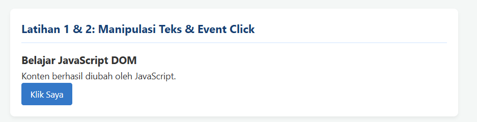
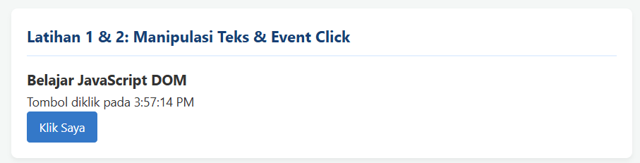

* **Latihan 3:**
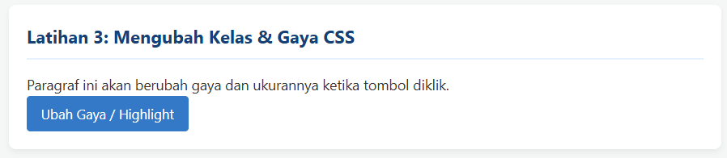
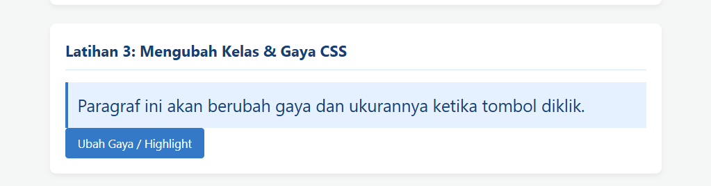

* **Latihan 4:**
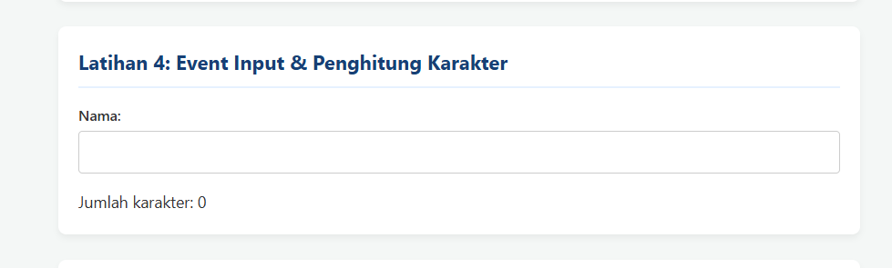
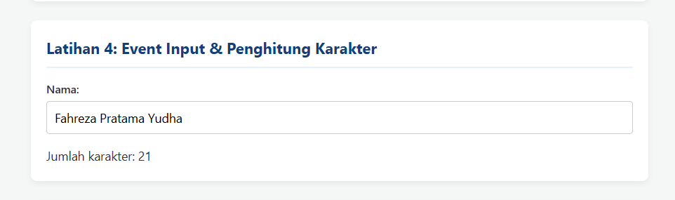

* **Latihan 5:**
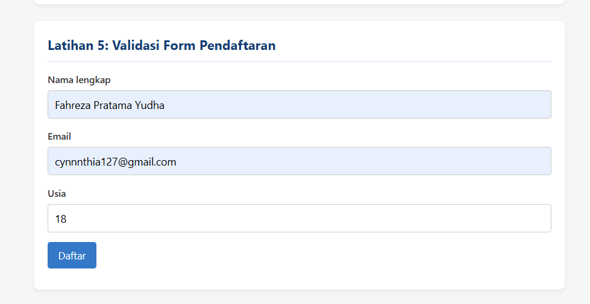
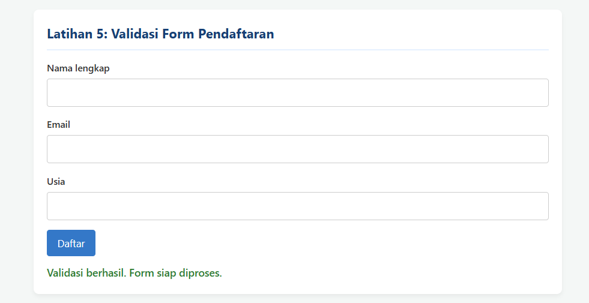

* **Latihan 6:**
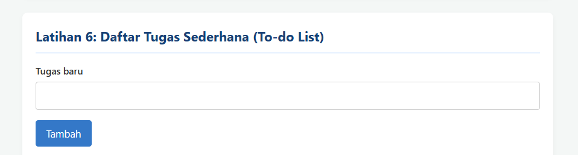
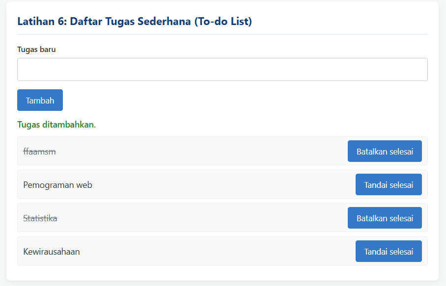

* **Mini Project:** 
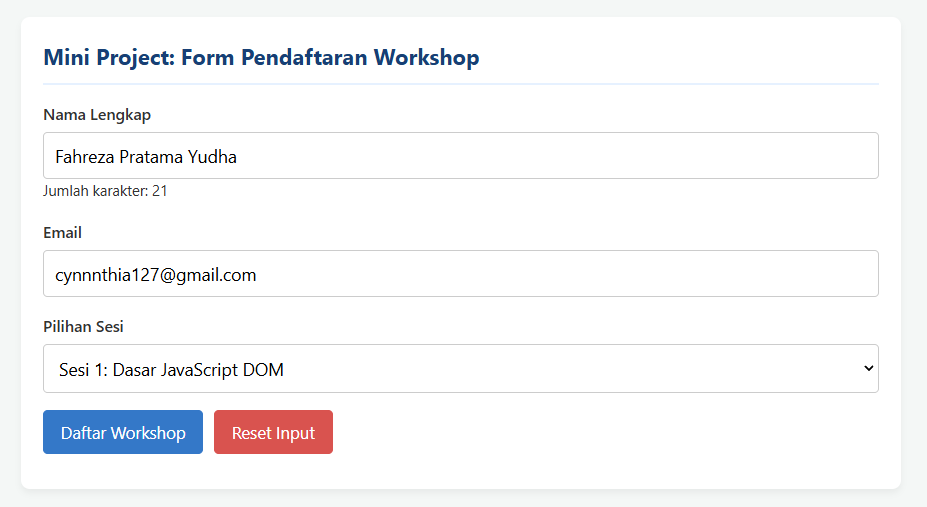
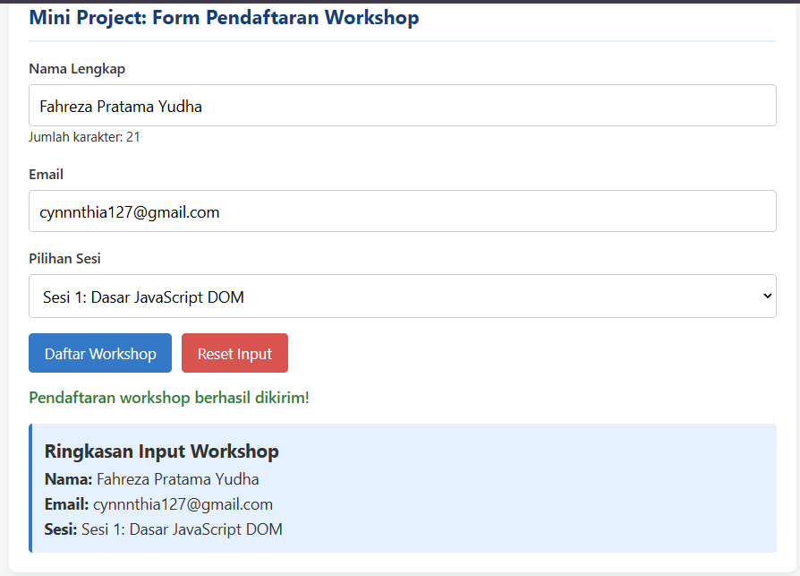
